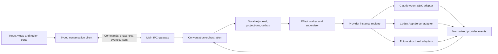
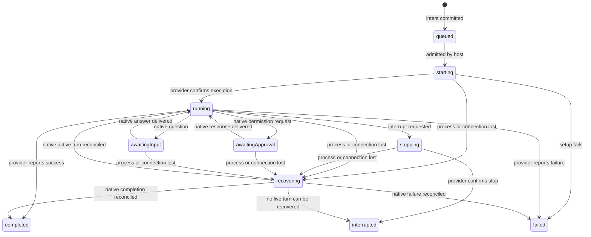

# Architecture proposal

Status: architecture and delivery contract, incorporating the supplied plan and approved UI decisions. Isolated foundation code now exists under `main/execution/` and `main/providers/`; see [progress.md](progress.md) for tested scope and gaps. No production runtime has been cut over.

## Ownership

The renderer owns presentation, drafts and focus. The execution host owns provider processes, workspace files, native session state and durable run state. Electron main composes local services and gateways; provider workers should be supervised outside React. The same host service contracts must support a remote worker without Electron dependencies.

A renderer reload or a closed conversation view does not stop execution. The approved shutdown policy keeps Nora running with a discoverable tray/reopen path after last-window close. Explicit Quit confirms interruption, stops reachable Nora-owned work and persists recovery. Unreachable remote work remains unconfirmed. These application lifecycle changes are not implemented by the isolated engine.

## Reuse before introducing modules

Reuse the [audited workspace, Git, IPC and shell boundaries](audit.md#existing-reusable-boundaries). Do not turn the current `Orchestrator` facade or `AgentSession` into the new engine through additional flags.

Suggested responsibility namespaces:

| Location | Responsibility |
| --- | --- |
| `shared/types/conversation/` | Environment/workspace references; conversations, turns, items, runtime requests, usage and typed failures. |
| `shared/types/provider/` | Driver/instance IDs, capabilities, model options and normalized provider-facing contracts. |
| `shared/ipc/types/` | Narrow conversation command, snapshot, history and subscription contracts. |
| `main/execution/` | Pure decisions/projection, environment-owned SQLite journal/outbox, command engine, admission, effects and recovery. |
| `main/providers/claude/`, `main/providers/codex/` | Native protocol/SDK boundaries, normalization and provider-specific permission mapping. |
| `main/types/` | Dedicated type files for host services, injected dependencies and provider internals. |
| `main/ipc/registerConversationIpc.ts` | One owner of conversation IPC registration. |
| Renderer `clients/`, `logic/`, `hooks/`, `views/` and UI feature folders | Typed gateway, projection helpers, subscriptions and approved views; hooks remain under app `hooks/`. |

No directories or speculative public APIs need to be created before a tested slice uses them. All named source types belong in dedicated `*.types.ts` files under the relevant types namespace.

## Domain model

| Entity | Meaning and invariants |
| --- | --- |
| Execution environment | The host that owns workspace access, provider configuration and execution. Its ID participates in all remote routing. |
| Workspace | Project checkout/worktree plus environment reference; paths retain host-native semantics. |
| Provider driver | Integration kind, initially Claude SDK or Codex App Server. |
| Provider instance | One configuration/authentication lifecycle on one environment; same-driver accounts must not share mutable state accidentally. |
| Conversation | Nora-owned stable identity, workspace binding, provider binding and history. It is independent of tab IDs and PIDs. |
| Native session reference | Provider instance, environment and native conversation/session IDs; optional until native creation succeeds. |
| Run/turn | One accepted user instruction or scheduled workflow step and its execution attempt(s). Nora and native IDs are separate. |
| Timeline item | Discriminated user/assistant message, available reasoning, tool, file-change, plan, subagent, failure or milestone item. |
| Runtime request | Approval or question associated with an attempt and provider request ID; explicit pending/resolved/expired state. |
| Handoff | Portable context with source conversation/item references, selected content, provenance and size information. |
| Terminal | Independent shell session. Running an agent CLI manually does not create a managed conversation. |

Separate persistent conversation history, host runtime handles and renderer view state. Avoid duplicating `isBusy` alongside contradictory status flags. Derive attention, running counts and completion summaries from authoritative state.

Provider-native subagents and Nora-scheduled conversations require distinct relationship kinds. Native subagent visibility does not imply Nora can individually interrupt or message that subagent.

## Provider contract

The engine depends on capabilities and normalized events, never raw SDK objects or terminal content. The initial adapter interface needs readiness/auth status, model discovery, session creation/resume, send, event subscription, interruption, request response and cleanup. Add fork/rollback/history/steering operations only with explicit capability semantics and implementation coverage.

Capabilities need enough detail to express actual supported choices: available reasoning levels, attachment kinds/limits, permission modes and approval decisions, native history/resume, subagent visibility and supported recovery. A generic `supportsPermissions: true` cannot describe provider-native options accurately.

Provider input is an untyped external boundary: validate it there, normalize it immediately, and keep native request routing private to the host. Do not forward arbitrary native payload objects into shared contracts. Preserve unsupported event diagnostics in a bounded host diagnostic channel without treating them as completed work.

### Codex evidence

[Official App Server documentation](https://learn.chatgpt.com/docs/app-server) describes a bidirectional structured protocol. Codex can generate its own protocol schemas; discovery used `codex-cli 0.132.0`, and local native acceptance now includes `0.167.0`. See [native acceptance](native-acceptance.md) for exact tested scope and schema evidence. Its schemas include:

- `initialize`, `thread/start`, `thread/resume`, `turn/start`, `turn/interrupt`, `turn/steer` and `model/list`.
- `item/agentMessage/delta`, item lifecycle notifications and `turn/completed`.
- Command/file/permission approval requests and tool user-input requests.

Initialize and wait for acknowledgement before sending `initialized` and subsequent commands. Track request correlation and native thread/turn/item IDs. Only a terminal turn status establishes execution outcome; a request response is insufficient.

Online documentation already describes history methods absent from the locally generated stable request schema. Current effort identifiers are runtime-advertised non-empty strings and are validated against the selected model. Version-check the installed binary and generate/pin bindings for supported versions; do not blindly implement against the newest website examples. Use the supported history methods of the negotiated version.

### Claude evidence

The [Agent SDK overview](https://code.claude.com/docs/en/agent-sdk/overview) distinguishes embedding the Claude harness from writing an application-owned tool loop. Nora now pins `@anthropic-ai/claude-agent-sdk@0.3.306`; authenticated Claude lifecycle acceptance remains pending.

[Sessions](https://code.claude.com/docs/en/agent-sdk/sessions) document native session IDs and continuation. [Streaming](https://code.claude.com/docs/en/agent-sdk/streaming-output) documents partial events in addition to complete messages; normalize both without duplicating text. [User input](https://code.claude.com/docs/en/agent-sdk/user-input) uses `canUseTool` for approvals and questions, with cancellation tied to the active request.

Authentication is an implementation investigation item. The official overview currently specifies API-key authentication for third-party products unless separately approved for claude.ai login. Do not assume current manual CLI authentication can be offered unchanged by the new integration. Verify supported account options before finalizing provider setup and credential migration.

### T3 evidence and applicability

Inspected the actual [adapter contract](https://github.com/pingdotgg/t3code/blob/main/packages/provider-core/src/server/ProviderAdapter.ts), [orchestrator](https://github.com/pingdotgg/t3code/blob/main/apps/server/src/orchestration-v2/Orchestrator.ts), [Claude adapter](https://github.com/pingdotgg/t3code/blob/main/apps/server/src/orchestration-v2/Adapters/ClaudeAdapterV2.ts) and [Codex adapter](https://github.com/pingdotgg/t3code/blob/main/apps/server/src/orchestration-v2/Adapters/CodexAdapterV2.ts), alongside its [architecture](https://github.com/pingdotgg/t3code/blob/main/docs/internals/overview.md) and [provider constraints](https://github.com/pingdotgg/t3code/blob/main/docs/internals/providers.md).

Adopt the separation of durable decisions from provider effects, environment ownership, provider-instance identity, and native continuation versus portable handoff. Nora should implement smaller responsibility-focused modules rather than copying large orchestration or React files or adopting T3's dependency stack without need.

## Durable commands and events

Storage uses a versioned environment-owned SQLite database through built-in `node:sqlite`, behind injected storage interfaces. Writable/restart/recovery smoke checks passed with Node 24.16.0 and bundled Electron 42.3.1; packaged and remote-platform validation remains required before production integration. Commands commit receipts, events, projections and effects atomically. Local files are protected with mode 0600. The ownership lease (introduced in schema v2) and `ExecutionHost` acquire sole environment ownership before recovery; `openLocalHost` supplies the composition. Schema v3 normalizes heads, runs, items and requests, migrating older execution snapshots transactionally while preserving journal cursors and receipts. Every engine mutation requires an injected ownership guard; process liveness checks occur outside transactions and claims compare the previous owner atomically.

Each accepted command transaction must atomically commit:

1. A durable command ID/receipt, with scoped idempotency semantics.
2. Ordered versioned domain events and materialized state.
3. Pending effects needed to carry out accepted intent.

Publish events only after commit. Keep network/process/filesystem work outside the transaction. A failed transaction must emit no successful acknowledgement or execution event.

The effect worker executes pending work, then submits normalized outcomes back through the engine. At most one active root turn per conversation; separate conversations may run concurrently. Persist queued instructions with edit/remove and explicit continuation after failure/interruption, as approved in D18/D28. Schedule loop roles and dependencies through these same commands and completion events.

Provider submission cannot generally be made atomic with Nora's database. If a host dies after a native turn starts but before its ID is committed, reconcile through native state where supported; otherwise expose an uncertain/interrupted attempt. Never blindly resubmit a possibly executed instruction. Claiming exactly-once provider execution would be incorrect.

### State transitions

This is an initial state model, not a finalized exhaustive reducer. Reconciled blocked requests must be restored only if the provider confirms they remain answerable; otherwise expire them. Closing a view is not a turn transition. Track post-turn diff/checkpoint finalization separately so it cannot make a completed provider look busy.

## Hydration, streaming and recovery

- Headers include an event cursor; subscribe/replay after that original cursor without a hydration/subscription gap. History pages have their own read cursor and must not reset the live replay baseline.
- Timeline/run pages use stable insertion positions with a maximum of 200 records. Streaming updates retain positions. Live execution reads active/queued work and a selected run rather than historical transcripts; full snapshots remain explicit export/debug queries.
- The isolated IPC gateway validates both directions and routes only to the named environment. Preload and renderer client factories are implemented but are not exposed on the live v2 bridge. Window-scoped subscriptions coalesce cursor hints; the client pulls bounded pages, handles hints arriving during replay and cleans up late watch registrations without interrupting native work.
- Scope subscriptions to project summaries and opened conversation histories. Paginate long histories and preserve stable item identities.
- Order events per conversation and deduplicate replayed events/items by stable IDs. Never append duplicate final messages after streamed deltas.
- If a cursor is unavailable or the schema is incompatible, request a new snapshot rather than silently dropping history.
- Distinguish renderer disconnection, remote-host disconnection and provider-process loss; losing one does not prove all execution stopped.
- Persist pending interaction metadata, but never reapply an approval after its native request has expired or been answered.
- Convert expected provider errors, authentication failures and usage limits into typed domain outcomes with meaningful messages.
- Batch high-frequency presentation updates without sacrificing durable event order or cancellation responsiveness.

## Review finalization

Schema v5 extends host-owned review effects with private, deduplicated before/after checkpoints. A baseline commits before native input. A terminal provider outcome schedules review atomically and remains visible while review finalizes in a separate worker group. Pending turn evidence reserves the checkout against later Nora starts, including overlapping roots, while independent checkouts and native controls continue. Workspace-only fallback reviews retain their independent scheduling.

Turn evidence compares saved working-tree bytes and is labeled changes **observed during the turn**, not proof of authorship or successful validation. Pre-existing edits are excluded; external writes during the interval can remain included. Provider-reported file changes stay separate. Bounded text patches and metadata cross IPC; snapshots remain private to the owning host. Plain folders still execute, with Git capture/review unavailable.

Review publication, run review status and effect retirement commit together. Saved pairs survive restart and rebuild review without recapture. Missing final capture, host/provider loss or uncertain native interactions cannot establish the original attribution boundary; retain evidence and expose unavailable/current-workspace scope. Schema upgrades preserve legacy history without fabricating checkpoints. See [checkpoint semantics and limits](checkpoints.md) for file coverage, resource bounds and pending restore/SSH/artifact work.

## Remote ownership and workspace conflicts

For SSH projects, provider execution, credential access, files and the authoritative store belong on the remote host. A local mount is not proof that a local provider may safely act as that host. Preserve mounting as a file-access feature while defining execution ownership explicitly.

Use the same normalized host API locally and over an authenticated SSH transport. Specify remote worker installation/version negotiation, reconnect cursors and host shutdown behavior before enabling remote managed execution. Do not fall back to local paths or local accounts when the remote host is unavailable.

Reuse worktree selection and writer/reader intent, but make admission leases host-owned and keyed by environment plus canonical checkout. The local authority resolves trusted registration records, merges symlink aliases and verifies real directory identity/branch before native submission; admission also rejects overlapping folder writers. Caller-supplied paths, branches and checkout IDs cannot authorize another folder. Deny or explicitly resolve conflicting writers; a read-mode label is not a provider sandbox. Filesystem restoration must check both workspace and native conversation rollback capabilities before applying changes.

## Data migration and retirement

1. Inventory legacy state for both home/repository storage modes and local/SSH environments, including renderer-owned chats and credential-bearing settings. The separate API Ask/Plan/spec runtime is retired in favor of native conversations (D39); preserve its history in archives.
2. Create a versioned migration manifest with source identity, checksums, imported/archive destinations and completion state. Back up source data before writes; migrations must be restartable and idempotent.
3. Preserve project/worktree IDs where appropriate. Map each legacy agent to an archived record with original provenance; attach a native conversation only through a supported, validated provider import/resume path.
4. Keep ANSI-only history as a clearly labeled archive, never fabricate structured messages or infer approvals from it. Import usable structured context with its precision/provenance intact.
5. Keep credentials in provider-owned storage or the appropriate OS secret facility; conversation tables and archives contain references only.
6. Present migration outcomes and unavailable native histories explicitly. Leave unreadable/unmigrated source records recoverable.
7. At each production cutover, migrate all entry points and remove the superseded managed runtime and contracts in the same deliverable. Temporary investigation code remains isolated from production routing and is removed or completed before cutover.

## Implementation slices

| Slice | Concrete deliverable | Exit criteria |
| --- | --- | --- |
| 1. Durable lifecycle | Minimal shared contracts, pure transition decisions, transactional store and effect worker with a provider double | Command retry is idempotent; acceptance differs from completion; crash/uncertain-submit recovery, replay, cancellation and stale approval tests pass; no renderer dependency. |
| 2. Codex native execution | Versioned stdio client, instance supervisor, event normalization and native lifecycle integration | Start/resume/send/interrupt, streaming, approvals/questions, process failure, auth/readiness and usage-limit cases covered; integration smoke test uses isolated state. |
| 3. Claude native execution | SDK instance lifecycle, partial/final reconciliation, request mapping and authentication setup | Equivalent lifecycle tests, supported model discovery, native resume, pending-request abort and package/runtime checks pass. |
| 4. Approved interface | Complete consultation artifacts, approved layouts, typed client hydration and shared conversation renderer | Explicit UI approval recorded first; switching/closing views leaves execution intact; narrow-window, keyboard, streaming and long-history checks pass. |
| 5. Workflow migration | Tasks/goals/loops, handoffs, Git/forge/editor/browser actions, workspace admission and SSH host | Every existing entry point uses the shared lifecycle; workflow completion depends on actual provider outcomes; local/remote acceptance matrix passes. |
| 6. Cutover and retirement | Restartable data migration, complete production routing change, legacy managed-path removal | No managed terminal input/output path or duplicate engine remains; manual shells and preserved data still work; migration/restart/regression checks pass. |

These are deliverables with explicit boundaries, not permission to leave partly migrated call sites. UI consultation can progress alongside slices 1–3. Do not enable a second production managed-agent workflow while leaving its migration and retirement undefined.

## Validation matrix

Use existing Node unit-test conventions and aliases. Add behavioral coverage for command decisions, transaction failure, retry idempotency, effect recovery, normalized provider fixtures, split UTF-8/JSONL frames, partial/final text reconciliation, late events, request expiry and stream termination. Use temporary databases and deterministic worker draining rather than sleeps.

Then validate native provider lifecycle, Electron packaging, multiple provider instances, concurrent worktrees, shutdown/restart, long histories and remote disconnect/reconnect. Provider smoke tests must state their authentication/cost requirements and must not become an implicit condition for all unit tests.

Required repository checks for implementation include `npm run test:unit`, `npm run check:path-hygiene`, `npm run check:shell-assembly-imports`, `npm run check:nora-bridge-usage` and a build where relevant. Use Node `24.16.0` or the repository-supported range: this environment's default `node` is `20.19.2`, while the required Node binary is available through nvm.
