# Nora v3 interface specification

Status: complete written specification reflecting [D1–D39](ui-discovery.md#owner-decision-record), explicitly approved for implementation on 2026-10-21. Final experience sign-off is separate and pending.

## Shell and information architecture

```text
┌─────────────────┬─────────────────────────────┬─────────────────────┐
│ All agents      │ Conversation / tool tabs    │ Changes | Files     │
│ Projects        ├─────────────────────────────┤                     │
│   Conversations │ Project · host · branch     │ Selected-turn diff  │
│                 │                             │ or workspace files  │
│   Project tools │ Messages and compact tools │                     │
│                 │                             │                     │
│                 │ Progress / approval / input│                     │
│ Settings        │ Composer + control row      │                     │
└─────────────────┴─────────────────────────────┴─────────────────────┘
```

Start with a 260px sidebar, centered transcript capped at 800px with 15px text, and review panel around 38% of available content width. Preserve usable reading/composer widths when panels compete. Persist widths, grid proportions and selected views separately from execution. Existing font and light/dark/system preferences remain authoritative. Neutral surfaces retain Nora branding and semantic status/diff colors.

Settings stays at sidebar bottom. Each project has pinned then recent conversations and collapsible tools. Rows show title, text/icon status and workspace/branch/environment badges. Meaningful activity updates ordering at stable boundaries such as submission, request arrival and turn completion; token deltas do not reorder. Completed conversations remain until explicitly archived. Disable archival while work or requests remain active and provide a separate interrupt action.

All agents shows running work and attention across projects with project, host, activity and elapsed time. Selecting an entry focuses its conversation. It reads the same engine projections as project navigation.

## Screen specifications

| Screen/surface | Layout and interactions | Empty, busy and failure behavior |
| --- | --- | --- |
| Project workspace | Sidebar, mixed tabs, optional Changes/Files. Project tools expose tasks/specs/notes/workflows/history/integrations. | Empty project offers New conversation and project tools; loading summaries use labeled placeholders. |
| All agents | Global active work/attention list, conversation links and supported interrupt. | No running work empty state; disconnected hosts remain visible with unconfirmed status. |
| Draft conversation | Inherited provider/model and effective policy in composer row; checkout/branch/host in header. | First message creates durable intent, then native execution. Missing readiness blocks send with setup action and preserves draft. |
| Writer conflict | Explain conflict and owner; offer existing conversation, another checkout or isolated worktree. | Admission waits for resolution; read/write intent does not claim sandbox enforcement. |
| Conversation | Header, centered timeline, progress/request and sticky input. User bubbles right, assistant text left. | Hydrate history before replay, stable IDs prevent duplicates; older-page loads preserve scroll. |
| Request | Native approval/question above composer with scope and actual native choices. | Answer is pending delivery until confirmed. Expired requests disable responses and explain reconciliation. |
| Tool output | Inline details plus larger labeled sheet/dialog for full output and copy. | Failed tools expand initially; long output paginates; closing restores opener focus. |
| Changes | Turn/workspace selector, file summary and diff; open diff in tab or split. | Show “Workspace changes — turn attribution unavailable” when needed. No attributed changes does not imply clean workspace. |
| Files/editor | Host/workspace tree in Files; regular editor tabs. | Local file errors preserve unsaved content; host loss remains explicit. |
| Workflow | Dedicated tab, steps/goals/loops and linked conversations. | Progress depends on confirmed outcomes; blocked/failed steps retain evidence and supported controls. |
| Relationships | Native subagents expand in parent activity; Nora-created children have parent links and navigation rows. | Unsupported native detail does not produce a fabricated standalone conversation. |
| Handoff | Preview selected context/provenance, target provider/conversation and effective settings. | Confirmation sends new instruction; failure preserves draft. No native session transfer. |
| Archive/history | Project browser separates v2, external CLI and retired API records, provenance and migration outcomes. | ANSI-only stays transcript; explicit capability-checked import/resume; unreadable sources retain location/reason. |
| Provider settings | Configured instances separate from integration kinds; readiness/auth/model controls. | Credentials stay provider-owned/OS-protected; typed auth/usage errors, no raw secret payloads. |
| Quit/recovery | Last-window close retains tray/reopen. Explicit Quit lists work and confirms interruption. | Stop reachable Nora-owned work, persist recovery, label unreachable remote stop unconfirmed. Reconcile before retry on restart. |

## Timeline and composer

Stream into stable assistant items. Follow only near the bottom; scrolling away suspends following and shows new-activity indication with Jump to latest. Jump restores following. No typewriter effect. Group related tools compactly, retaining milestones, activity, elapsed time and supplied plan steps. Provider-supplied reasoning starts collapsed. Failed tools expand without stealing focus.

Keep the final response central with a compact result bar linking only available changes/validation evidence. Missing evidence produces no success badge. Checkpoint/review finalization has separate status from native completion.

The sticky composer includes input, removable attachment/context chips and provider/model/reasoning/permission row. Keep workspace/branch/environment in the header. Show effective policy before send; access broadening requires explicit action. Hide unsupported controls; disable temporarily unavailable supported operations with a reason.

@ opens file/context mentions; / opens supported commands/skills. Add/paste/drop create labeled chips; rejected content gives a local error without clearing text. Enter sends idle or queues busy; Shift+Enter inserts newline. Composition events and `isComposing` prevent IME submission. Buttons expose their Send/Queue action accessibly.

Drafting remains enabled during execution. A queue strip above input shows ordered unsent messages with edit/remove. Editing changes only unsent intent. Steering is separate and capability checked. Interrupt preserves drafts/queues; failure/interruption pauses queued dispatch until explicit continuation/removal. Retry/Resume is offered only after capability and uncertainty checks; uncertain execution is never silently repeated.

## State presentation

| State | Timeline/header | Composer/request controls |
| --- | --- | --- |
| Idle/draft | Workspace and effective settings | Send, with readiness and admission validation |
| Queued | Accepted and waiting, distinct from running | Edit/remove unsent instruction |
| Starting | Starting native turn | Queue; supported interrupt |
| Running | Current activity and elapsed time | Queue; optional steering; interrupt |
| Awaiting approval/input | Attention badge and active request | Draft/queue and native response choices |
| Stopping | Awaiting confirmed stop | Draft/queue; repeated interrupt disabled |
| Completed | Final response/evidence | Send next; review may still finalize |
| Failed/interrupted | Typed inline outcome and retained evidence | Draft, paused queue and supported explicit Retry/Resume |
| Recovering | Reconnecting/reconciling; outcome unconfirmed | Draft/queue; expired requests disabled; no blind resubmit |
| Auth/usage failure | Actionable provider explanation | Retain input/queue; valid setup/retry action |

## Tabs, grids, responsiveness and accessibility

Preserve 1–4 columns and 1–2 rows for mixed surfaces. Keyboard-adjustable separators persist proportions. Closing a view removes presentation only; Stop/Archive are separate. Terminal from conversation inherits host/checkout.

Switch supporting panels to sheets before chat becomes unusable. If saved grids cannot fit usable pane minima, focused-pane mode preserves the grid for restoration. Exact breakpoints/minima are tuning values to validate with real content and keyboard interaction, not new product decisions. Do not shrink controls beyond usability or discard saved panes.

Reuse Radix primitives, theme tokens and region ports. Every control has labels, visible focus and keyboard access. Dialogs/sheets restore focus; streams do not steal it. Status includes text/icons, not color alone. Honor reduced motion. Announce meaningful requests/outcomes rather than every token. Background requests/failures produce badges/desktop notifications; completion notifications are configurable. Notification activation focuses the relevant conversation.

## Component inventory and ownership

Names identify responsibilities rather than prescribing long exports. Reuse/extract existing focused components first.

| Region | Responsibilities | State owner |
| --- | --- | --- |
| Navigation | Conversation list/row, badges, project tools, All agents, archives | Summary projections via sidebar ports; local filters/expansion |
| Center | Mixed tabs, pane frame, adjustable grid, focused pane, workspace header | View/layout persistence and session-center ports |
| Timeline | Pager, messages/reasoning, activity, milestone, subagent, result/failure | Normalized host history; pure shaping outside React |
| Composer | Input, chips, mentions/commands, provider controls, queue editor, progress/request | React drafts/focus; host queue and requests |
| Review | Changes/Files, scope, file summary, diff/output viewer | Changes ports and explicit attribution |
| Tools | Workflow steps, handoff preview, editor/browser/forge, manual terminal | Existing domains and typed conversation commands |
| Global | Provider setup, notifications, quit/recovery, migration results | Host lifecycle/settings; modals/chrome ports |

Hooks live in `renderer/components/app/hooks/`, shaping in `logic/`, app entry views in `views/`, dedicated contracts in `types/`. Shell regions consume `use<Region>Ports()` from memoized composition. Raw provider payloads never reach React.

## Interaction diagrams

```mermaid
sequenceDiagram
  actor User
  participant View
  participant Host
  participant Store
  participant Provider
  User->>View: Send or queue
  View->>Host: Command with stable ID
  Host->>Store: Atomic receipt/events/projections/effects
  Store-->>Host: Committed cursor
  Host-->>View: Intent accepted, not work completed
  Host->>Provider: Effect outside transaction
  Provider-->>Host: Items or requests
  Host->>Store: Persist normalized updates
  Host-->>View: Ordered events after commit
  User->>View: Answer request
  View->>Host: Response command
  Host->>Provider: Native response
  Provider-->>Host: Confirmed outcome
  Host-->>View: Final outcome; review finalizes separately
```



```mermaid
stateDiagram-v2
  [*] --> Draft
  Draft --> Queued: durable intent
  Queued --> Starting: admitted
  Starting --> Running: native confirmation
  Running --> Request: approval or question
  Request --> Running: response delivered
  Running --> Stopping: interrupt
  Stopping --> Interrupted: confirmed stop
  Running --> Completed: confirmed success
  Starting --> Failed: setup failure
  Running --> Failed: native failure
  Starting --> Recovering: host loss
  Running --> Recovering: host loss
  Request --> Recovering: host loss; expire old request
  Stopping --> Recovering: host loss
  Recovering --> Running: active native turn reconciled
  Recovering --> Completed: success reconciled
  Recovering --> Failed: failure reconciled
  Recovering --> Interrupted: absence confirmed
```

View closure/reload is absent from execution transitions. Provider change goes through handoff into a target retaining its own native identity.

## Review checkpoints

No unresolved product choice blocks written-spec review. Capability discovery, exact responsive thresholds and platform tray behavior require truthful implementation validation. Backend tests do not establish UI acceptance.

Before frontend work, explicitly approve the complete specification and decision record. Before final sign-off, review both themes, narrow/split layouts, keyboard/IME/screen-reader paths, long streaming histories, background requests, diff fallback and restart recovery. Record this experience review separately from implementation approval.
